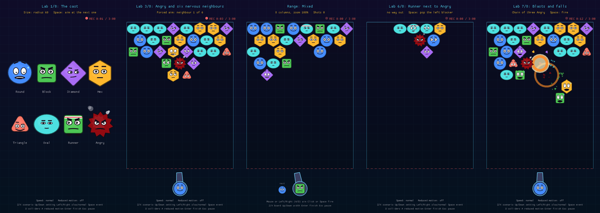

# Rust a move

[](https://github.com/ricande/rust-a-move/actions/workflows/ci.yml)
[](LICENSE)
[](Cargo.toml)
[](https://github.com/ricande/RustyHusky)

**Aim with fear. Match with spite.**

*Rust a move* is an original, Snood-inspired portrait aim-and-match game
with grumpy geometric creatures, written in Rust with
[Macroquad](https://macroquad.rs). Shoot a creature into the hanging board;
three or more of one family disappear and whatever no longer hangs from the
ceiling falls.

The twist: **there is no aiming line.** The creature your shot would hit
first is visibly terrified instead – so you aim by reading faces.

- **Angry** is always furious. Aiming at it changes nothing, and it hides
  everything behind it. Hit it directly and it explodes, taking its
  neighbours with it – and other Angry ones in the blast go off too.
- Everyone **next to an Angry** is nervous and keeps a worried eye on it.
- **Runners** wear a sweatband. When a straight path to the side opens, they
  struggle free and escape; next to an Angry they bolt at once.
- Six ordinary families – Round, Block, Diamond, Hex, Triangle and Oval –
  each with its own shape, colour and personality, all drawn in code.



## Status

Work in progress, built milestone by milestone
([implementation plan](docs/game/06_IMPLEMENTATION_PLAN.md),
[verification record](docs/VERIFICATION.md)):

| Milestone | Content | State |
| --- | --- | --- |
| M0 | Project from the RustyHusky template, design docs | done |
| M1 | Procedural characters and the animation lab | done |
| M2 | Board, shared shot prediction, fear aiming, shooting range | done |
| M3 | Matching, falls, score, ceiling pressure, win/lose and retry | done |
| M4 | Angry blasts and chain reactions | done |
| M5 | Runners | done |
| M6 | Levels, saved options, tutorial | done |
| M7 | Recording and platform review, release candidate | next |

Today the game is playable: match three or more, drop hanging clusters,
blow up Angry creatures and set off chain reactions, watch runners escape,
beat the descending ceiling, win by clearing the board or lose at the
danger line – then Retry or go on to the next level. The setup screen also opens the **shooting range** (a test
bench for aiming) and the **animation lab** (every expression and effect).

### How to play

- Aim with the mouse or Left/Right. There is no aiming line: **the creature
  your shot will hit first looks terrified.** Click or press Space to fire.
- Shots bounce off the side walls and stick next to what they hit. Three or
  more of the same family disappear (10 points each); everything that no
  longer hangs from the ceiling falls (20 points each).
- **Angry** (the jagged dark-red one) is always furious and never shows
  whether you aim at it – and hides everything behind it. Its neighbours
  look nervous. Hit it directly and it explodes, taking every creature next
  to it (10 points each); other Angry ones in the blast explode too, in a
  chain. Angry never matches, and if it falls it does not explode.
- **Runners** wear a sweatband and little feet. When a straight path to the
  side opens they struggle for a moment and then dash off the board (10
  points) – whatever hung only from them falls. Next to an Angry they
  panic and bolt as soon as a way opens. They still match with their
  family. Runners only move while you aim, never while a shot flies.
- Every fifth shot the ceiling – and the whole board with it – comes down
  one row. The pips at the top count down to the next drop.
- Clear the board to win. If any creature reaches the dashed danger line,
  or a shot finds no room, the level is lost.

## Quick start

```bash
git clone https://github.com/ricande/rust-a-move.git
cd rust-a-move
cargo run --release
```

On Debian/Ubuntu, install the build packages first (see
[Requirements](#requirements)). Choose **Play**, then the shooting range or
the animation lab.

## Controls

**Setup screen** (before every round): Up/Down choose, Left/Right change,
Space or Enter start; or the mouse (click the left or right half of a
setting to lower or raise it). **Play** starts the level. **Width** sets the
number of creatures in a long row (6–18) and with it their size; **Zoom**
(75–100 %) scales the whole board. The next board is shown dimmed behind
the menu, so you see what they do. **Reduced motion**, **Reduced flashes**
(blasts without the white flash) and **Effects** (fewer fragments) never
change the rules. Everything is saved for the next rounds. **How to play**
explains the game on one page, and each teaching level shows a one-line
hint until your first shot. Esc or P pauses in every mode.

**Playing**

| Key / mouse | Action |
| --- | --- |
| Mouse, or Left/Right (A/D) held | aim, 10°–170° (the keyboard keeps the aim until the mouse really moves) |
| Click in the field, or Space | fire |
| Esc / P | pause (Resume or Abort round) |

After a win the results offer **Next round**, after a loss **Retry** (the
same board again); both keep Save video / Discard video.

**Shooting range** (Enter ends the round)


| Key / mouse | Action |
| --- | --- |
| Mouse, or Left/Right (A/D) held | aim, 10°–170° (the keyboard keeps the aim until the mouse really moves) |
| Click in the field, or Space | fire |
| Z / X | previous / next test board: mixed, ceiling gaps, curtain (bank shots), pocket |
| Up / Down | board size: 8, 6, 12, 18 columns at zoom 100 %, 18 and 6 at 75 % |

**Animation lab** (Enter ends the round)

| Key | Action |
| --- | --- |
| Z / X | previous / next scenario (eight in all) |
| Up / Down | the scenario's setting (size, aimed neighbour, route, blast type, width) |
| Left / Right | slow motion (¼ speed) / normal speed |
| Space | the scenario's event (aim, restart, pop a blocker, fire) |
| D | collider overlay |
| A | reduced motion |

With `RUST_A_MOVE_DEV=1` the range also has development overlays: S shows
the colliders and W the predicted shot path. Normal play never shows a
trajectory.

## How it is built

- **One shot calculation for fear and flight.** The shot planner traces the
  projectile with continuous collision (rays against colliders, side-wall
  reflections) and the same plan decides who is afraid and where the shot
  stops, so they cannot disagree. Tests compare it with an independent
  fine-step simulation over 1 200+ random shots.
- **Deterministic, window-free logic** at a fixed 120 steps per second, with
  an owned seeded random generator; drawing only reads the state.
- **Procedural characters:** body shape, face (eyes, pupils, brows, mouth)
  and motion are blended from moods (nervous, afraid, relieved, panicking),
  with a reduced-motion mode that keeps every expression.
- **Hex board:** alternating rows of N and N − 1 cells, six neighbours, one
  circular collider for every shape; 6–18 columns and 75–100 % zoom.

Details: [architecture](docs/ARCHITECTURE.md), [rules](docs/GAME_RULES.md),
[technical design](docs/game/03_TECHNICAL_DESIGN.md).

## From the RustyHusky template

Rust a move is built on the [RustyHusky](https://github.com/ricande/RustyHusky)
template 0.3.0 (commit `91c257d8e60ca381768dde0258e04d745a30d184`), which
provides the portrait view, menus, settings, pause, English/Swedish texts and
automatic gameplay recording. Changes to the template's framework files are
listed in [docs/FRAMEWORK_PATCHES.md](docs/FRAMEWORK_PATCHES.md).

### Template features

- **Portrait 9:16 gameplay** – a logical 540 × 960 view, scaled to any window
  without cropping or stretching, with correct mouse coordinates.
- **Automatic gameplay recording with audio** – every round is recorded
  while you play, including the game's sound effects.
- **1080 × 1920 MP4 video at 60 fps** – H.264 video with AAC stereo sound,
  independent of the window size.
- **Save or discard the recording after a level** – nothing is written to
  your video folder until you choose Save video.
- **A reusable foundation for quickly building new games** – menus,
  settings, pause, results, scaling and recording are done; you replace one
  game module.
- **English by default, with i18n support** – all texts go through one
  translation catalog; Swedish is included.

The template grew out of [RustOut](https://github.com/ricande/RustOut), a
Breakout-style game. It draws everything in code and synthesizes its sounds,
so the game needs no files at run time.


## Requirements

- Rust (stable, 1.87 or later) via [rustup](https://rustup.rs)
- Linux: development packages for X11, ALSA and OpenGL, e.g. on Debian/Ubuntu:
  `sudo apt install libx11-dev libxi-dev libgl1-mesa-dev libasound2-dev`
- Windows and macOS need nothing extra to build.
- To record videos: [FFmpeg](https://ffmpeg.org) with the libx264 encoder, in
  `PATH` (Debian/Ubuntu: `sudo apt install ffmpeg`; macOS: `brew install
  ffmpeg`; Windows: an FFmpeg build such as the one from gyan.dev, with its
  `bin` folder in `PATH`). It is only needed at run time, not to build.
  Without it everything works except recording, and the settings and results
  screens say why.

## Running

```bash
cargo run --release
```

Tests (game rules and geometry, flow, settings, translations, scaling,
recording pipeline) run without a window; the video tests are skipped when
FFmpeg is missing:

```bash
cargo test
```

See [docs/DEVELOPMENT.md](docs/DEVELOPMENT.md) for the full set of checks,
scripted runs and development mode.

## Menus and flow

| Screen   | Keys / mouse |
| -------- | ------------ |
| Menus    | Mouse, or ↑/↓ and Enter (Space also chooses). Esc goes back. |
| Settings | ←/→ change the focused setting; click the left or right half of the volume button to lower or raise it. |
| Round    | Esc or P pauses. In the pause menu: Resume (also Esc/P) or Abort round. |
| Game     | See [Controls](#controls). |

Flow: **main menu → round → results → next round or main menu**. An aborted
round also ends on the results screen (without "Next round").

## Settings

Saved as `settings.json` in the data folder and loaded at the next start:

| Setting   | Values                    | Default |
| --------- | ------------------------- | ------- |
| Language  | English, Svenska          | English |
| Volume    | 0–100 % in steps of 10 %  | 80 %    |
| Recording mode | Prioritize recording, Prioritize gameplay, Off | Prioritize recording |

A change of recording mode applies from the next round. Files from earlier
versions with `"recording": true` / `false` are read as Prioritize recording /
Off; a saved `recording_mode` is always kept.

Data folder: `$XDG_DATA_HOME/rust-a-move` (normally
`~/.local/share/rust-a-move`) on Linux, `~/Library/Application
Support/Rust a move` on macOS, `%APPDATA%\Rust a move` on Windows. A missing or
broken file gives the defaults.

## Video recording

Unless the recording mode is Off and as long as FFmpeg is available, every
round is recorded. The two modes differ in what gives way when the computer
cannot keep up:

| | Prioritize gameplay | Prioritize recording (default) |
| --- | --- | --- |
| Game speed | Real time, always | Follows the video: each video frame is exactly two physics steps (2 × 1/120 s). If frames cannot be produced 60 times per second, the game runs slower. |
| Video | 60 fps on the game's clock. Pictures are repeated or skipped to match the display's frame rate, so motion is only as smooth as the display rate. | Exactly one new picture per video frame, so motion is always smooth and at normal speed. |
| Encoder too slow | The recording stops with a message; the round goes on. | The game waits for it ("Waiting for the video encoder…" after 1 s). The window, pause and abort keep working. |
| Encoder hung | Stopped once its queue (about 0.4 s) is full. | Stopped after 5 s without progress; the round goes on in real time. |

Example: if the computer only manages 30 video frames per second in
Prioritize recording, a minute of play takes about two minutes, and the saved
file is one minute long and plays smoothly at 60 fps.

Both modes:

- **What:** only the game view, rendered separately at 1080 × 1920 (9:16),
  60 fps, H.264 – independent of the window size, without window borders,
  letterbox bars, the REC marker, the pause menu or the results screen.
- **When:** the first video frame (time 0) shows the round before any
  physics step; the last one shows the frame the level was finished (or the
  last frame before an abort). The video is exactly as long as its frames:
  number of frames / 60 s. Paused time adds nothing to game time, video or
  sound.
- **Length limit:** a video is at most 3:00 (`MAX_VIDEO_SECONDS` in
  `src/config.rs`; `None` removes the limit), the longest a YouTube Short may
  be. If a round lasts longer, recording stops at exactly 3:00 and the game
  goes on; the window shows "Video full (3:00)" and the results explain it.
  A game decides its own level length; to fit a whole level in a Short, keep
  it a little under 3:00.
- **Afterwards:** the results screen shows "Finishing the video…" while the
  encoder finishes, then **Save video** and **Discard video**. Until you save,
  the video is only a temporary file in the system's temp folder. Leaving the
  results screen without saving discards it.
- **Where:** `~/Videos/Rust a move/rust-a-move-<date>-<time>.mp4` (UTC; the
  Linux folder follows `XDG_VIDEOS_DIR`, macOS uses `~/Movies`, Windows
  `%USERPROFILE%\Videos`). Existing files are never overwritten; `-2`, `-3` …
  is added instead. The results screen shows the saved path.
- **REC marker:** while recording, the window shows "● REC 0:42 / 3:00",
  the length of the video so far and its limit, in yellow for the last ten
  seconds. It is never part of the video.
- **Sound:** the video has a stereo AAC sound track with the game's sound
  effects, placed by game time (in Prioritize recording, the time of the
  video frame in which they happened), so it stays in sync however long the
  recording took. It is
  always mixed at full effect volume, whatever the volume setting. Sounds
  from outside the game (other programs, the microphone) are not recorded,
  and menu sounds are never part of the video.
- **Errors:** a missing FFmpeg, an encoder that crashes, hangs or is too
  slow, or a file that cannot be written is shown as a message on the
  results screen; the game keeps working. A failed save can be retried.
- **Never stuck:** frames go through a bounded queue of 24 pictures (about
  0.4 s, at most about 200 MB). Frames are never dropped, so a saved video
  is always complete and in sync, or there is none. When a recording fails,
  the window shows "Recording stopped", the results show why, FFmpeg is
  stopped and the round continues in real time. The FFmpeg check at startup
  is limited to 5 s, finishing and saving a video to 60 s.
- **Clean-up:** temporary files are removed on Discard, on leaving the
  results, and when the program closes (also via the window's close button,
  which stops any running FFmpeg at once, including a save in progress).
  Leftovers after a crash are removed at the next start once they are a day
  old.

## Template updates

Rust a move changes some RustyHusky framework files. Do not run
`scripts/update-framework.sh` blindly: it overwrites them. Follow
[docs/FRAMEWORK_PATCHES.md](docs/FRAMEWORK_PATCHES.md) and the template's
[docs/NEW_GAME.md](docs/NEW_GAME.md).

## Environment variables

Handy for testing without touching your real settings and videos. The
prefix is `config::ENV_PREFIX` (`RUST_A_MOVE` here):

| Variable | Effect |
| -------- | ------ |
| `RUST_A_MOVE_DATA_DIR` | folder for `settings.json` |
| `RUST_A_MOVE_VIDEO_DIR` | folder for saved videos |
| `RUST_A_MOVE_LANG` | `en` or `sv`, overrides the saved language for this run |
| `RUST_A_MOVE_FFMPEG` | path to the ffmpeg program (a wrong path simulates missing FFmpeg) |
| `RUST_A_MOVE_WINDOW` | force a window size, e.g. `1000x640` |
| `RUST_A_MOVE_SCRIPT` | run a UI script instead of real input (see [AGENTS.md](AGENTS.md)) |
| `RUST_A_MOVE_SHOTS` | folder for the script's screenshots (default `shots`) |
| `RUST_A_MOVE_DEV` | `1` turns on development overlays in the shooting range |

## Documentation

| Document | Contents |
| -------- | -------- |
| [docs/GAME_RULES.md](docs/GAME_RULES.md) | The authoritative game rules (R01–R14) |
| [docs/ARCHITECTURE.md](docs/ARCHITECTURE.md) | Modules, coordinates, time step, i18n, recording flow |
| [docs/DEVELOPMENT.md](docs/DEVELOPMENT.md) | Building, checks, scripted runs, development mode, code tour |
| [docs/VERIFICATION.md](docs/VERIFICATION.md) | What was verified per milestone, how, and what was not |
| [docs/game/](docs/game/README.md) | Design package: decisions, technical design, characters and animation, configuration, plan, test specification, template audit |
| [docs/FRAMEWORK_PATCHES.md](docs/FRAMEWORK_PATCHES.md) | Changes to RustyHusky framework files, to reapply after a template update |
| [docs/NEW_GAME.md](docs/NEW_GAME.md) | The template's guide to building a game on it |
| [docs/UPSTREAM_FIXES.md](docs/UPSTREAM_FIXES.md) | The patched miniquad: symptom, cause, verification, how to remove it |
| [AGENTS.md](AGENTS.md) | Rules and checks for contributors and AI agents |
| [CONTRIBUTING.md](CONTRIBUTING.md) | How to contribute |
| [CHANGELOG.md](CHANGELOG.md) | Changes per version |
| [LICENSE](LICENSE) | GPL-3.0-or-later |
| [THIRD_PARTY_NOTICES.md](THIRD_PARTY_NOTICES.md) | RustOut (MIT), dependencies, FFmpeg, recorded videos |

## Known limitations

- Recording needs FFmpeg with libx264 at run time.
- Recording reads each frame back from the GPU (8 MB per frame), which costs
  some frame time while recording. The video is still exactly 60 fps
  (pictures are repeated or skipped to match game time).
- In Prioritize gameplay, recording needs a CPU that encodes 1080 × 1920
  H.264 (`veryfast`) at 60 fps in real time; on a slower or very busy machine
  it is stopped with a message rather than slowing the game. Prioritize
  recording works on slower machines, at the cost of a slower game while
  recording. The frame queue can use up to about 200 MB while the encoder is
  behind.
- In Prioritize gameplay, motion in the video is only as smooth as the
  display's frame rate: at 30 Hz every picture is shown twice. The file is
  60 fps either way.
- On the shooting range a direct hit on an Angry only uses up the shot,
  and runners stay put; both work in the game.
- Seven hand-made levels at 8 columns; every other level and width is
  generated. Generated boards are valid and connected, not proven solvable.
- Rust a move builds against a patched copy of miniquad 0.4.11 in `vendor/`
  that fixes black text rectangles (macroquad#1006); see
  [docs/UPSTREAM_FIXES.md](docs/UPSTREAM_FIXES.md). Building it prints one
  or two warnings (depending on the platform) from miniquad's own, unchanged
  code.
- The video sound contains only the game's synthesized effects.
- The start window size is fitted to the screen on X11/XWayland (via `xprop`
  and `xrandr`); elsewhere it starts at 360 × 640. It can always be resized.
- The built-in font covers Latin text (English and Swedish), not every script.

## License

Rust a move, like RustyHusky, is free software, licensed under the GNU
General Public License, version 3 or (at your option) any later version (GPL-3.0-or-later). The full
text is in [LICENSE](LICENSE).

- Code reused from [RustOut](https://github.com/ricande/RustOut) keeps its
  original MIT copyright and permission notice, in
  [LICENSES/MIT-RustOut.txt](LICENSES/MIT-RustOut.txt).
- The Rust dependencies and FFmpeg keep their own licenses. See
  [THIRD_PARTY_NOTICES.md](THIRD_PARTY_NOTICES.md).
- Gameplay videos you record are not automatically covered by the code
  license. Separate rights to any assets you use (graphics, music, sounds,
  fonts) still apply.
- Inspired by the game principle of Snood; no Snood artwork, sounds,
  character names or levels are used. All creatures are original and drawn
  in code.
